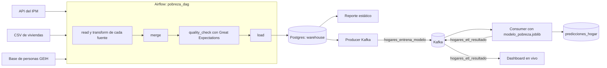

# Predicción de pobreza multidimensional (IPM) en Colombia

Universidad Autónoma de Occidente, Facultad de Ingeniería y Ciencias Básicas. Programa de Ingeniería de Datos e Inteligencia Artificial. Curso ETL (G51), entrega final.

Integrantes:
- Sebastián Alejandro Jiménez Solís
- Laura Valentina Loaiza Díaz
- Santiago Lourido Rodríguez
- Carlos Fabián Córdoba

## Qué hace el proyecto

Este repositorio continúa el proyecto de la entrega 2 (pobreza, pobreza extrema e indigencia en Colombia). Se conservan las tres fuentes, el DAG de Airflow, las validaciones con Great Expectations y los notebooks de EDA. Sobre eso se agregó un modelo que predice si un hogar es pobre según el IPM, un flujo en Kafka que predice hogar por hogar, un dashboard en vivo y un reporte estático.

Todo corre con un solo comando de Docker Compose, sin instalar Python, Airflow ni Kafka.

El texto completo de la entrega 2 (fuentes, verificación cruzada, supuestos) está en [docs/entrega2.md](docs/entrega2.md).

## Fuentes de datos

Las tres fuentes son las mismas de la entrega 2.

- API del IPM (DANE), en `http://201.32.130.152/api/productos`. Es la fuente del IPM y de la variable `pobre`.
- CSV de viviendas, `viviendas_pdtos.csv`, con 86.848 hogares. Aporta las condiciones de la vivienda.
- Base de datos de personas y pobreza monetaria de la GEIH (tablas `dim_geografia`, `dim_persona`, `fact_personas` y `fact_hogares`). Aporta el contexto económico de cada departamento.

Se combinan en dos niveles. Las tres se unen por departamento (tabla `merge_departamento`, 33 filas, solo 24 departamentos tienen las tres fuentes). El IPM y el CSV se unen por hogar para armar el dataset del modelo.

## Arquitectura



El producer es un servicio aparte, no una tarea del DAG. El dashboard lee del topic de predicciones, no consulta la base de datos. Los diagramas de la entrega 2 siguen en `diagramas/`.

## Cómo correrlo

Se necesita Docker con Docker Compose v2 (Docker Desktop en Windows y Mac), unos 6 GB de memoria disponibles para Docker y conexión a internet, porque una de las fuentes es una API. En Windows con WSL2 conviene subir la memoria en el archivo `.wslconfig`.

1. Descargar los datos y dejarlos en `data/` como dice [data/README.md](data/README.md).
2. Confirmar que `models/` tiene los tres archivos del modelo (ver [models/README.md](models/README.md)).
3. Desde la raíz del repositorio:

```
docker compose up --build
```

La primera vez construye las imágenes y tarda varios minutos. Al arrancar, Airflow ejecuta el DAG una vez por su cuenta. El producer y el reporte esperan a que el DAG cargue la vista `vw_dataset_prediccion`, así que los primeros mensajes aparecen unos minutos después.

## Qué se abre en el navegador

- Airflow: http://localhost:8080 (usuario y contraseña `admin`). Vista Graph del DAG `pobreza_dag`.
- Dashboard en vivo: http://localhost:8501.
- Reporte estático: http://localhost:8000/reporte_estatico.html.
- Warehouse (Postgres): `localhost:5433`, base `warehouse`, usuario y contraseña `etl`. Solo para uso local.

## DAG de Airflow

El DAG `pobreza_dag` tiene 14 tareas.

```
read_api ──► transform_api ──┐
read_csv ──► transform_csv ──┼─► merge ─► quality_check ─► load ─► store
read_db  ──► transform_db  ──┘                  │
                                                └─► merge_hogar ─► quality_check_hogar ─► load_hogar ─► store_hogar
```

La primera parte es la de la entrega 2 y deja la tabla `merge_departamento`. La segunda parte es nueva: une el IPM con el CSV por hogar, arma el contexto de cada departamento, valida y carga `fact_hogar_ipm`, `contexto_departamento` y la vista `vw_dataset_prediccion`.

Decisiones de diseño:
- Cada tarea guarda su resultado en un archivo temporal y la siguiente lo lee.
- Si una validación de Great Expectations falla, la tarea falla, las siguientes no corren y las tablas finales no se tocan.
- La carga es idempotente: las tablas se reemplazan completas (`if_exists='replace'`) y la vista se borra y se vuelve a crear. Repetir el DAG no duplica filas.
- Solo las tareas de lectura y de carga se reintentan.
- `max_active_runs=1` y `catchup=False`.
- En Docker el DAG corre una vez al arrancar (`@once`). Después se lanza a mano con el botón de play. En la entrega 2 el horario era `@daily`.
- El DAG lee sus rutas y conexiones de variables de entorno: `ETL_BASE`, `ETL_STAGING`, `CSV_PATH`, `DATABASE_URL`, `DESTINO_URL`, `API_URL` y `DAG_SCHEDULE`. Los valores para Docker están en `docker-compose.yml`.

## Calidad de datos

Hay 7 suites de Great Expectations: una por cada fuente transformada (API, CSV, hogares de la base, personas de la base), una para el merge por departamento y dos para la parte nueva (`suite_fact_hogar_ipm` y `suite_contexto_departamento`). Cada resultado se registra en `validation_log.csv`. En Docker queda en el volumen de Airflow (`/opt/airflow/salidas/reports`); `reports/validation_log.csv` es el de las corridas en Colab. En la última corrida del notebook las 7 suites cumplieron todas sus reglas.

## Modelo dimensional

- `fact_hogar_ipm`: una fila por hogar (86.848). Tiene el IPM, la variable `pobre`, el factor de expansión y las condiciones de la vivienda.
- `contexto_departamento`: una fila por departamento (33), con el contexto económico y de vivienda.
- `merge_departamento`: la tabla de la entrega 2, una fila por departamento.
- `vw_dataset_prediccion`: vista que une el hecho con el contexto y es el dataset del modelo (86.848 filas).
- `split_modelo`: ids de los hogares de prueba. La crea el servicio `warehouse-init` desde `models/ids_streaming.csv`.
- `predicciones_hogar`: la llena el consumer, una fila por mensaje procesado.

La métrica que se publica en Kafka es la probabilidad de que un hogar sea pobre según el IPM. El grano del evento es un hogar.

## Modelo de ML

El notebook `notebooks/04_modelo.ipynb` predice la variable `pobre` de cada hogar. Sirve como tamizaje para priorizar hogares, no reemplaza el cálculo del IPM.

- División 60/20/20 en entrenamiento, validación y prueba. El 20 % de prueba es el que se publica en Kafka.
- Gana HistGradientBoosting, con umbral 0.1975 elegido en validación.
- En prueba: ROC-AUC 0.849, PR-AUC 0.387 (la proporción base de pobres es 0.082), precisión 0.36 y recall 0.56. Con departamentos que el modelo no vio, ROC-AUC 0.811.
- El pipeline completo (preparación, preprocesamiento y modelo) se guarda en `models/modelo_pobreza.joblib`. El consumer lo carga una sola vez.
- Las columnas de entrada salen de `src/features_pobreza.py`, el mismo archivo que usan el notebook, el producer y el consumer.

Límites conocidos: las variables de vivienda alimentan 4 indicadores del IPM, y en zona rural dispersa el modelo marca 43 % de hogares como pobres frente a 21 % reales. Con el umbral elegido, de cada 100 hogares marcados como pobres solo 36 lo son. Por eso se usa para priorizar y no para decidir.

## Streaming con Kafka

El detalle de los mensajes, las variables y las decisiones está en [streaming/README.md](streaming/README.md). En resumen:

- Producer (`streaming/producer.py`): lee de `vw_dataset_prediccion` los hogares de `split_modelo` y publica uno cada `DELAY_SEG` segundos en `hogares_entrena_modelo`. Nunca publica `pobre`, `ipm` ni el factor de expansión.
- Consumer (`streaming/consumer.py`): valida cada mensaje, predice con el modelo, publica la predicción en `hogares_etl_resultado` y la guarda en `predicciones_hogar`. Un mensaje repetido no duplica la fila.
- Dashboard (`dashboard/app.py`): es otro consumer de `hogares_etl_resultado`. Se actualiza solo y no consulta la base.

Para cambiar la velocidad o parar el producer se puede copiar `.env.example` a `.env` y editar `DELAY_SEG`, `MAX_MENSAJES` y `CICLOS`.

### Broker del servidor del curso

Para usar el broker compartido en vez del Kafka del compose se copia `.env.servidor.example` a `.env.servidor` y se corre:

```
docker compose --env-file .env.servidor up --build --no-deps producer consumer dashboard
```

En ese modo no se escribe en `hogares_stream` ni en `felicidad_ws`, que son de otros proyectos. El archivo `.env.servidor` no se sube al repositorio.

## Reporte estático

`reportes/reporte_estatico.py` consulta el warehouse con SQL y genera `reports/reporte_estatico.html`. No usa Kafka. En Docker se genera solo cuando el DAG termina. Para regenerarlo con los datos actuales del warehouse:

```
docker compose restart reporte
```

## Notebooks y EDA

En `notebooks/` están los de las entregas anteriores (`01_fuente_api_ipm_def`, `02_fuente_csv_def`, `03_fuente_base_de_datos_def`), el merge y el DAG (`merge_definitivo`), el modelo (`04_modelo`) y el de Streamlit analítico (`streamlit_visualizaciones_definitivo`). Las gráficas del EDA están en `graficas/eda/` y los hallazgos en `reports/hallazgos_*.md`.

La carpeta `streamlit/` tiene la app analítica de la entrega 2. Es estática y no es el dashboard en vivo, que está en `dashboard/`.

## Apagar

```
docker compose down        # apaga y conserva los datos del warehouse
docker compose down -v     # apaga y borra todo
```

## Si algo falla

- `docker compose logs airflow-init` muestra si faltan archivos en `data/`.
- `docker compose logs producer` muestra si sigue esperando al DAG.
- Si la API del IPM no responde, la tarea `read_api` falla y el resto no corre. Se puede relanzar desde Airflow cuando vuelva.
- En Linux, si hay problemas de permisos, correr con `AIRFLOW_UID=$(id -u) docker compose up --build`.

## Estructura

```
dags/          DAG de Airflow
airflow/       imagen de Airflow con Great Expectations
streaming/     producer y consumer de Kafka
dashboard/     dashboard en vivo (Streamlit)
reportes/      código del reporte estático
reports/       logs de validación, hallazgos del EDA y reporte generado
streamlit/     app analítica de la entrega 2
src/           columnas de entrada del modelo y utilidades de Kafka
scripts/       preparación del warehouse y espera del DAG
notebooks/     notebooks de EDA, merge, modelo y Streamlit
models/        modelo serializado
data/          datos de entrada (ver data/README.md)
diagramas/     diagramas de la entrega 2
graficas/      gráficas del EDA y capturas del dashboard analítico
docs/          README de la entrega 2
tests/         pruebas de la lógica de streaming
```

Las pruebas de lógica no necesitan Docker: `python tests/test_streaming.py`.

## Archivos de configuración

- `.env.example`: variables opcionales para el compose (velocidad del producer, usuario de Airflow).
- `.env.servidor.example`: variables para usar el broker del servidor.
- `.env.notebooks.example`: variables de la entrega 2 para Colab o ejecución sin Docker. No copiarlo como `.env` si se va a usar Docker Compose.
